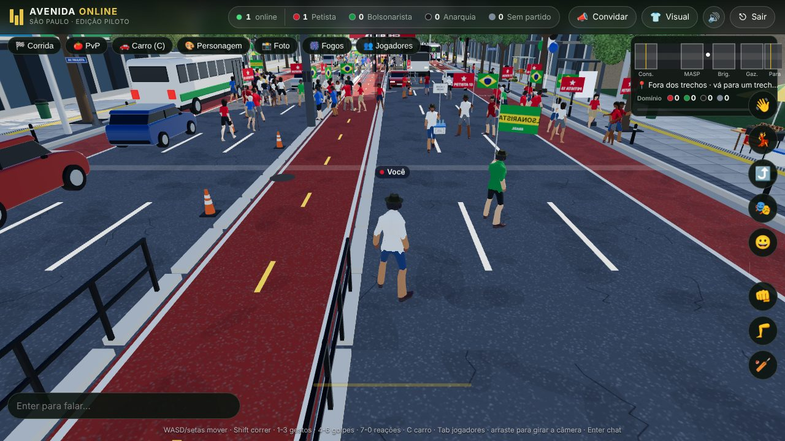
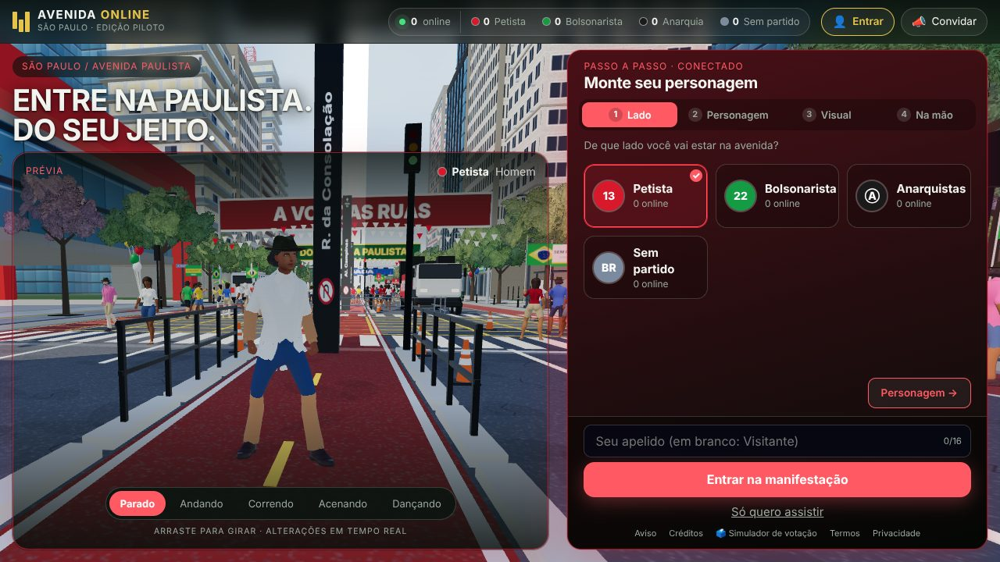

# Avenida Online

[](https://github.com/alissondroid/manifestacao/actions/workflows/ci.yml)  

Mundo 3D multiplayer no navegador, ambientado na Avenida Paulista. Escolha um lado, monte seu personagem, converse, corra, dispute trechos da avenida e curta shows de fogos com outras pessoas em tempo real. Sem instalar nada: abre em qualquer navegador moderno, no computador ou no celular.



<details>
<summary>Mais um print: lobby</summary>



</details>

## Destaques

- **Mundo 3D** com a Paulista estilizada: ciclovia, faixas, prédios, MASP, ônibus, carros e multidão de figurantes (gráficos ajustados sozinhos conforme o desempenho).
- **Multiplayer em tempo real** (WebSocket): chat, reações, gestos, presença por área de interesse e até 300 jogadores por padrão.
- **Quatro lados** para escolher, **Domínio da Paulista** (disputa por trechos), **corrida** e **PvP opcional** (murro, chute, cassetete, carro).
- **Personagem personalizável**: corpo masculino ou feminino, roupa, cores, acessórios, cartaz, bandeira e camisa com texto próprio. Todos os itens são grátis.
- **Fogos de artifício** com som sintetizado e shows em horários fixos.
- **Simulador de votação** em `/votacao`, com urna eletrônica e cidades brasileiras.
- **Moderação** embutida: silenciar, denunciar, banimento por conta/IP e filtro de palavras.
- **Sem dependências pesadas**: Three.js no cliente, Node 22 com `ws` e SQLite embutido (`node:sqlite`) no servidor. Sem TypeScript e sem banco externo.

## Início rápido

Requer **Node 22+**.

```bash
git clone https://github.com/alissondroid/manifestacao.git
cd manifestacao
npm install
npm run dev      # servidor WebSocket (8787) + Vite em http://localhost:5180
```

Produção (um único processo serve o build e o WebSocket):

```bash
npm run build && npm start   # http://localhost:8787
```

| Comando | O que faz |
|---|---|
| `npm run dev` | Servidor e Vite com recarga automática |
| `npm run build` | Build do cliente e pré-compressão (gzip/brotli) |
| `npm start` | Servidor em produção (serve `dist/`) |
| `npm test` | Testes (`node --test`, banco em memória; rode `npm run build` antes) |
| `npm run lint` | ESLint |

`GET /healthz` responde `{ok, players, uptime}` para monitoramento. O servidor trata `SIGTERM`/`SIGINT` fechando conexões e banco.

## Configuração

Copie `.env.example` para `.env`. Tudo é opcional em desenvolvimento.

| Variável | Padrão | Para quê |
|---|---|---|
| `PORT` | `8787` | Porta do servidor |
| `PUBLIC_URL` | | URL pública (https em produção): valida a origem do WebSocket e ativa HSTS |
| `MAX_PLAYERS` / `MAX_PER_IP` | `300` / `5` | Limites de jogadores |
| `AOI` | `70` | Raio de interesse (m): só chega quem está perto |
| `DB_PATH` | `data/avenida.db` | Arquivo SQLite (`:memory:` nos testes) |
| `TRUST_PROXY` | | `1` atrás de nginx/Caddy/Cloudflare, para o IP real chegar |
| `ADMIN_TOKEN` | | Liga a API de administração (denúncias e banimentos); 16+ caracteres |
| `BLOCKED_WORDS` | | Palavras mascaradas no chat, separadas por vírgula |
| `SHOW_TIMES` | `12:00,20:00` | Horários dos shows de fogos (Brasília); vazio desliga |
| `GOOGLE_CLIENT_ID` | | Login com Google (opcional) |

## Controles

| Ação | Teclado | Celular |
|---|---|---|
| Andar | WASD / setas | Joystick na tela |
| Correr | Shift | |
| Gestos | 1 e 2 | Botão 🎭 |
| Golpes (com PvP ligado) | 4, 5, 6 | Botões na tela |
| Reações | 7 a 0 | Botão 😀 |
| Carro | C | Botão 🚗 |
| Chat | Enter | |
| Lista de jogadores | Tab | Botão 👥 |

## Estrutura

```
server/    servidor HTTP + WebSocket (jogo, contas, moderação, shows, votação)
shared/    constantes e regras compartilhadas entre cliente e servidor
src/       cliente: mundo 3D, avatares, multidão, interface, áudio, efeitos
public/    modelos .glb, ícones, termos e política de privacidade
votacao/   página do simulador de votação
deploy/    scripts de VPS (setup, update, checagem de segurança) e unidade systemd
scripts/   conversores e ferramentas de desenvolvimento
test/      testes automatizados (regras, servidor real via WebSocket, segurança)
docs/      documentação detalhada
```

O servidor é a fonte da verdade: valida velocidade, golpes, itens e texto. O cliente só desenha e envia intenções (veja o protocolo na documentação).

## Hospedagem

Precisa de um processo Node 22 sempre ligado, com WebSocket e disco; não serve para Vercel/serverless. Em uma VPS Ubuntu:

```bash
DOMAIN=seu-dominio.com bash deploy/setup.sh
```

O script instala Node e Caddy (HTTPS automático), cria o serviço `systemd` com sandbox, o firewall e o backup diário do SQLite. O deploy contínuo está em `.github/workflows/deploy.yml`. Detalhes na [documentação](docs/DOCUMENTACAO.md#hospedagem-vps-ubuntu).

## Documentação

- [Documentação completa](docs/DOCUMENTACAO.md): arquitetura, protocolo, modos de jogo, moderação, segurança
- [Como contribuir](CONTRIBUTING.md) · [Segurança](SECURITY.md) · [Código de conduta](CODE_OF_CONDUCT.md)
- [Licenças de terceiros](ASSETS.md) · [Changelog](CHANGELOG.md)

## Fazendo um fork

- Troque `avenidaonline.com` pelo seu domínio (`grep -rl avenidaonline.com index.html votacao public server src deploy docs`).
- Preencha `public/termos` e `public/privacidade` (campos `[PREENCHER]`) com um advogado, ou use `deploy/preencher-legal.sh`.
- Os corpos são o do Ready Player Me (masculino) e o do Quaternius, CC0 (feminino). Para adicionar outros, veja "Modelos 3D" na documentação e confira a licença de cada arquivo.

## Aviso

Projeto independente, sem vínculo com candidatos, partidos ou campanhas. Os nomes e números identificam apenas os lados da disputa, em tom de brincadeira. Não há nenhum personagem com aparência de pessoa real. Revise a legislação eleitoral e os termos de uso antes de publicar uma instância.

## Licença

Código sob [MIT](LICENSE). Modelos e animações de terceiros têm licenças próprias: [ASSETS.md](ASSETS.md).
